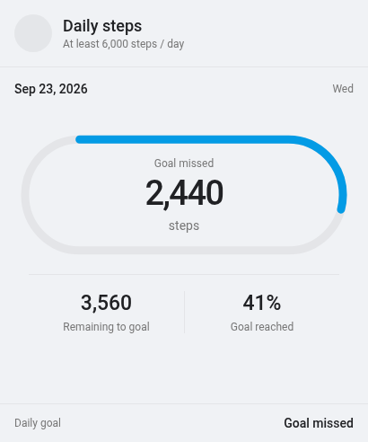
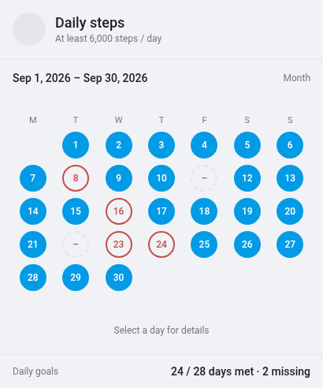
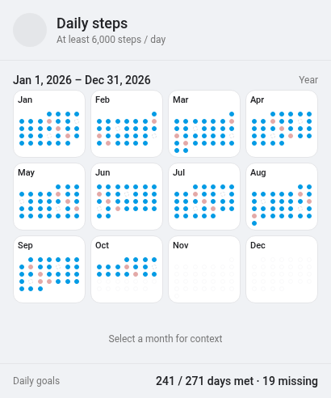

# Daily Goals Card

Daily Goals Card shows whether you reached a daily target directly on your Home Assistant dashboard.

## What it does

Track steps, electricity limits, water use, or any other numeric measurement with a daily goal. The card follows Home Assistant's Energy date selection, so you can move between a single day, week, month, year, or custom date range.

### See progress at a glance

Each day clearly shows whether your goal was met, missed, still in progress, or has no recorded data. You can set a minimum goal, such as walking at least 6,000 steps, or a maximum goal, such as using no more than 10 kWh per day.



### Review weeks, months, and years

The layout changes automatically for the selected period. Tap a day for its details or select a month to take a closer look.





## Install with HACS

Make sure you have [HACS](https://hacs.xyz/) installed in Home Assistant.

[](https://my.home-assistant.io/redirect/hacs_repository/?owner=gabbro246&repository=daily-goals-card&category=plugin)

1. Click the button above to open Daily Goals Card and confirm adding the repository if prompted.
2. In HACS, download **Daily Goals Card**.
3. Reload your browser.
4. Edit your dashboard and add the built-in **Energy date selection** card, followed by **Daily Goals Card**.

If the button does not work, add https://github.com/gabbro246/daily-goals-card through HACS > Custom repositories, selecting **Dashboard** as the repository type. Then follow steps 2-4.

## Set up a daily goal

Add the card through Home Assistant's dashboard editor. Select one or more entities to measure, enter a fixed daily goal or choose an entity containing the goal, and decide how the daily value should be calculated.

For example, this tracks a step counter that resets each day:

```yaml
- type: energy-date-selection
- type: custom:daily-goals-card
  title: Daily steps
  entities:
    - sensor.daily_steps
  goal: 6000
  direction: min
  aggregation: max
```

Use `direction: min` when you want to reach at least the goal. Use `direction: max` when the goal is a limit you do not want to exceed.

Choose the daily calculation that matches your entity:

- `max` uses the highest recorded value. Choose it when one high reading matters, or for a daily counter that only moves upward.
- `change` uses how much a continuously increasing meter advanced, rather than its displayed reading. Choose it for a total that carries over between days.
- `state` uses the last recorded value and ignores earlier readings. Choose it when only the end-of-day result matters.
- `mean` uses the average of the recorded values. Choose it when the overall daily level matters more than brief highs or lows.
- `min` uses the lowest recorded value. Choose it when one low reading should determine the result for the whole day.

### Combine multiple measurements

Select multiple entities when several measurements contribute to the same goal:

```yaml
- type: custom:daily-goals-card
  title: Household steps
  entities:
    - sensor.alex_daily_steps
    - sensor.sam_daily_steps
  goal: 10000
  direction: min
  aggregation: max
```

The card adds their daily values together. For today, each entity has its own color and can be shown or hidden from the legend. Finished days show only whether the combined goal was met. Use entities with the same unit and daily calculation.

Use the **Show measurement legend** switch in the card editor, or set `show_legend: true` or `show_legend: false` in YAML. New cards default to hiding the legend.

Use the **Day marker styles** grid to choose **Filled**, **Outlined**, or **Symbols** separately for successful days, unsuccessful days, and days without data. For example, successful days can be filled while unsuccessful days use symbols.

The no-data style also applies when a day's goal is unavailable. Choose Symbols for a plain gray dash without a circle.

The matching YAML options are `success_style`, `failure_style`, and `no_data_style`. Each accepts `filled`, `outline`, or `symbols`:

```yaml
  success_style: filled
  failure_style: symbols
  no_data_style: outline
```

Existing cards that use `finished_style` continue to work as before for successful and unsuccessful days.

Enable **Start week on Sunday** in the card editor, or set `start_week_on_sunday: true` in YAML. Calendars start on Monday by default.

### Use a changing goal

Select a goal entity instead of entering a fixed number when your target can change:

```yaml
- type: energy-date-selection
  collection_key: energy_goals
- type: custom:daily-goals-card
  entities:
    - sensor.daily_steps
  goal_entity: input_number.daily_steps_goal
  direction: min
  aggregation: max
  collection_key: energy_goals
```

When you use more than one Energy date selection card, give each pair the same `collection_key`. The key must begin with `energy_`.

## History and recorded data

Daily Goals Card reads Home Assistant's Recorder history and long-term statistics. The selected measurement must be recorded, and long-term views work best with an entity that provides long-term statistics.

Home Assistant normally keeps helper history for a limited time. If you use an `input_number` as a changing goal, older targets may eventually become unavailable. Use a goal sensor with long-term statistics if you want to preserve changing goals for year views.

## Additional information

Found a bug or have a suggestion? Feel free to [open an issue](https://github.com/gabbro246/daily-goals-card/issues).

Daily Goals Card uses Home Assistant's Energy date selection to choose its visible period. Because this relies on an internal frontend feature, a future Home Assistant update may require a card update.

Licensed under the [MIT License](LICENSE).
